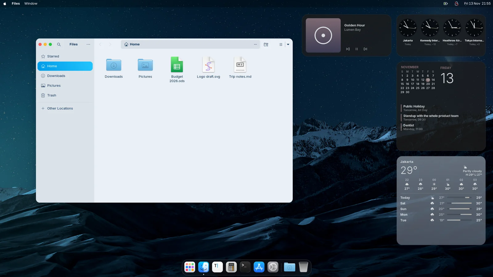
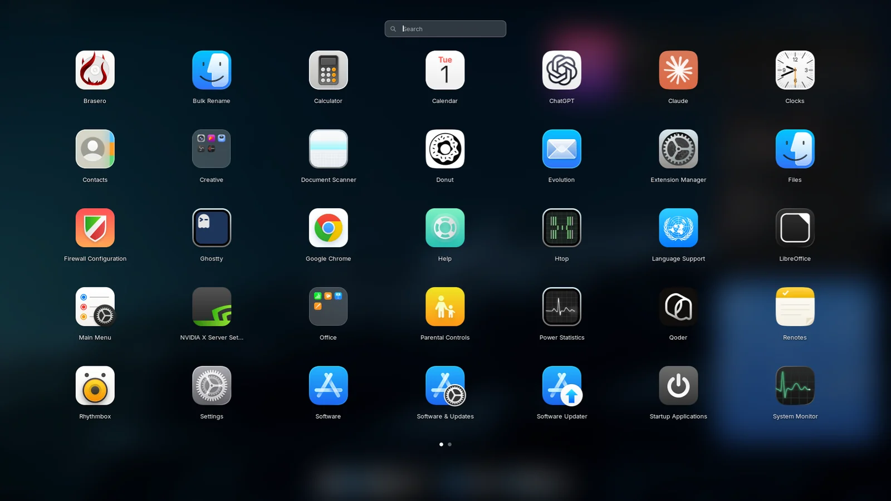
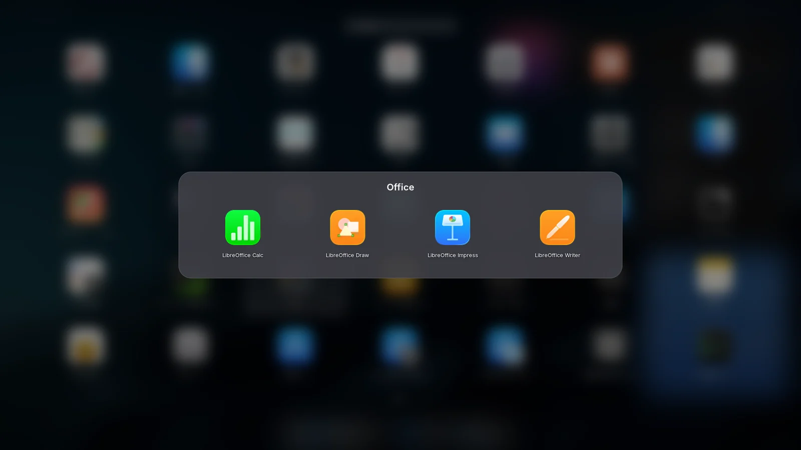
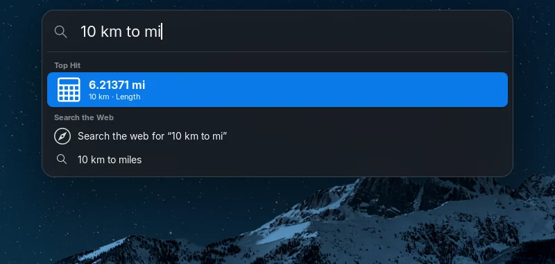
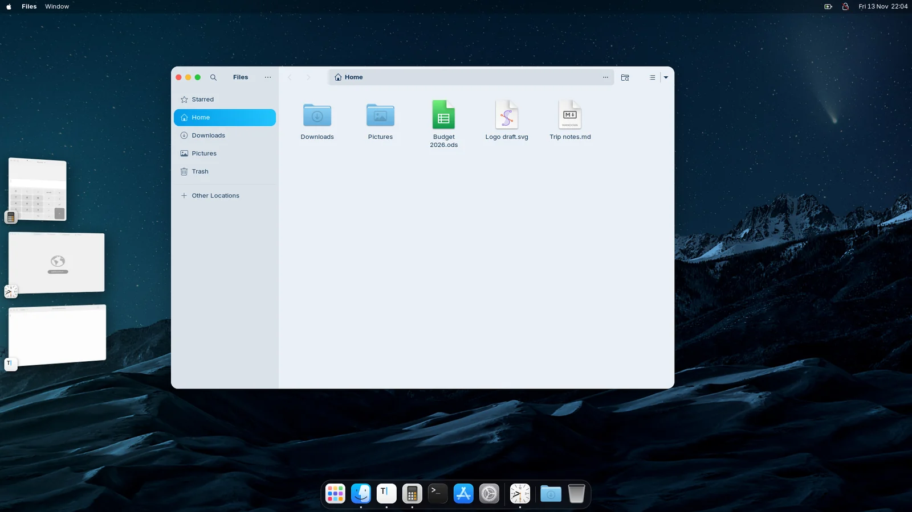
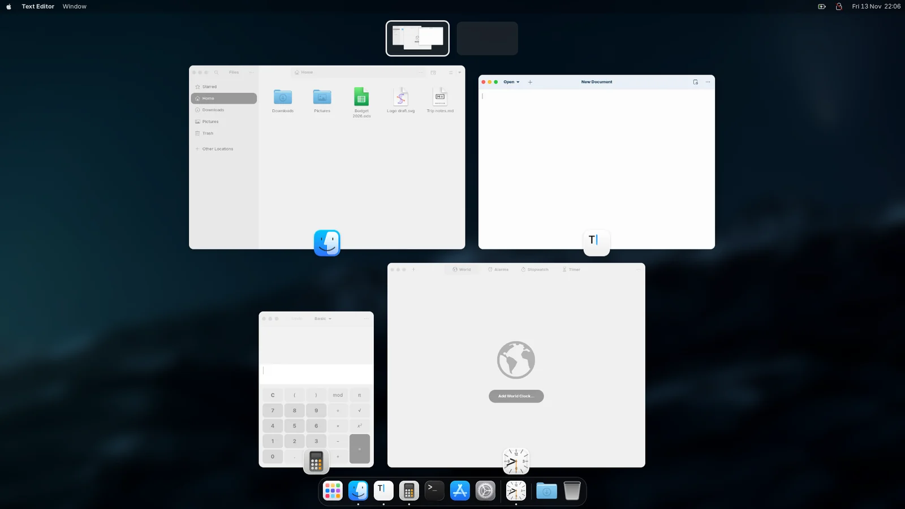
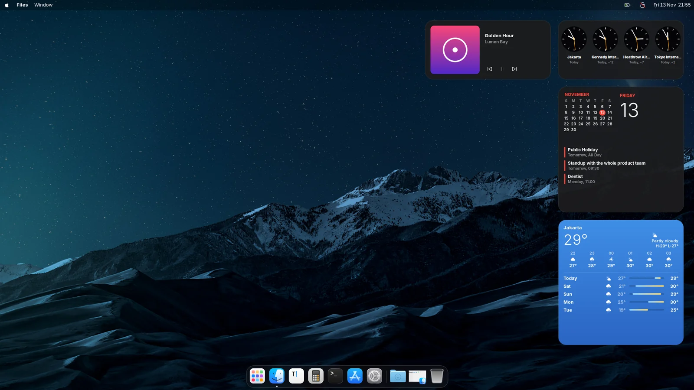
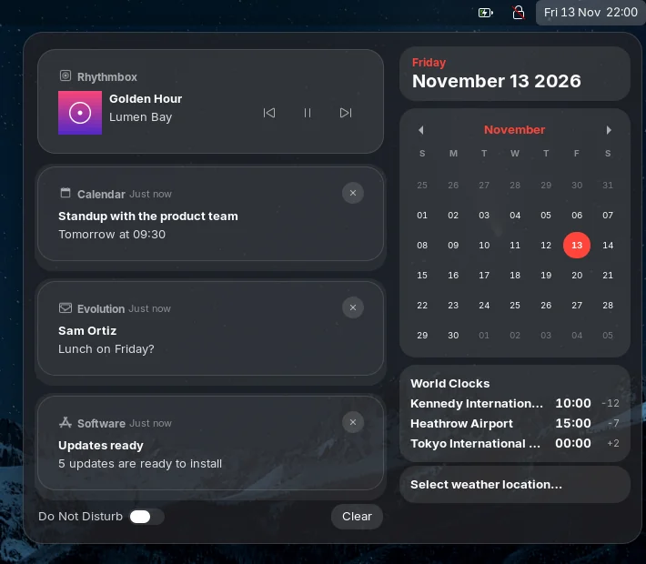

<div align="center">

# Macr

**The complete macOS experience for your Linux desktop.**

One GNOME Shell extension that turns GNOME into macOS: the menu bar, the Dock,
Launchpad, Spotlight, Stage Manager, Mission Control and the small touches in
between, instead of a stack of tweak extensions that each fix one corner.

[Install](#install) · [What's new](#whats-new-in-06) · [Features](#features) · [Shortcuts](#keyboard-shortcuts)

</div>



## What's new in 0.6

- **Folders in Launchpad.** Drag one app onto another to make a folder, named
  after what the apps have in common. Click its name to rename it, drop more
  apps in, or drag one out to take it back to the grid.
- **Bouncing Dock icons.** An app's icon bounces while it opens, and three
  times when it needs your attention.
- **Stage Manager on every monitor.** Each screen keeps its own app in the
  middle and its own strip on the left.
- **Minimized windows in the Dock.** They wait as small thumbnails before the
  Trash, with their app's icon in the corner, until you click one.
- **The Dock on the left or right**, as well as along the bottom.
- **Clipboard history.** Ctrl+Super+V lists what you copied in the last
  eight hours, text and pictures, kept in memory only.
- **Trackpad gestures.** Pinch four fingers for Launchpad, spread them to show
  the desktop, swipe down for App Exposé.
- **Show Desktop.** A hot corner slides your windows to the screen edges, as on
  macOS, and clicking the wallpaper can do the same (opt in).
- **Shake to find.** Shake the pointer and it grows for a moment so you can
  spot it.
- Mission Control keeps its windows above the Dock.

## Features

Every part is a module you can turn off on its own in Macr's settings, which
are laid out like macOS System Settings.

### Menu bar and Control Center

- A logo menu, the focused app's name and its menu, and the app's
  own File, Edit and View menus when it shares them (GTK apps with a menu bar,
  LibreOffice), plus a Window menu.
- Wi-Fi, Bluetooth and battery menus of their own, a macOS clock and a
  translucent bar, on every monitor.
- **Control Center**: GNOME's quick settings as macOS tiles, toggles first,
  titled Display and Sound sliders, a Focus (Do Not Disturb) toggle with a moon
  in the bar, and a Stage Manager toggle.
- **Volume and brightness** show as a small frosted pill under the menu bar at
  the top right.

### Dock

- Frosted glass, magnification, running dots, and red badges and progress
  bars from apps such as Telegram and Thunderbird.
- Icons bounce while their app opens and when it needs your attention.
- A Downloads stack that fans out or shows your newest downloads in a grid,
  stacks for any folder you add, and the apps you quit last.
- Minimized windows as thumbnails before the Trash, and the genie effect when
  you minimize.
- Hides when a window covers it. Sits along the bottom or down the left or
  right side, on every monitor.

### Launchpad and Spotlight

|  |  |
|---|---|

- **Launchpad**: every app in a full-screen grid with pages and search, on
  Super and the Dock's Launchpad icon. Drag one app onto another to make a
  folder.
- **Spotlight**: Ctrl+Space searches apps, files, settings and the calculator
  through GNOME's search providers, and answers unit and currency conversions
  ("10 km to mi", "$20 in rupiah"), word definitions and web searches with
  suggestions. The online lookups can be turned off.
- **Quick Look**: Space on a file in the Downloads stack, or Super+Y on a file
  in Spotlight, previews it; the arrow keys go to the next file.

<p align="center"></p>

### Windows



- **Stage Manager** (opt in): the app you use stays in the middle and your
  other apps wait as tilted thumbnails on the left of each monitor. Click one
  to swap it in, or reach it from the Dock, Alt+Tab or Mission Control. Turn
  it on in the Control Center.
- **Mission Control**: your windows spread over the dimmed wallpaper, above
  the Dock, with the Spaces bar always at the top.
- **App Exposé**: all of one app's windows spread over the blurred screen,
  minimized ones in a row at the bottom. Super+Down, or Show All Windows in a
  Dock icon's menu.
- **Full-screen Spaces**: an app that goes full screen gets a workspace of its
  own next to the one it left, and goes back when it leaves full screen.
- **Traffic lights**: red, yellow and green buttons on the left of app windows,
  grey in background windows, with their symbols on hover and the macOS Move &
  Resize, Fill & Arrange and Full Screen menu when the pointer rests on the
  green one. They work in GTK and libadwaita apps, Chrome and X11 apps; Qt 6
  apps on Wayland and Electron apps with their own title bar draw their own.
- **Window tiling**: drag a window to a screen edge for a half, to a corner for
  a quarter or to the top to fill it, with a frosted preview of where it goes,
  and drag it away to get its size back. Also on the keyboard and in the
  Window menu's Move & Resize, with margins between tiles.
- **Window corners**: rounded corners on windows that do not round their own,
  such as frameless (Electron) and older X11 apps, with a soft shadow on
  frameless ones; square when maximized.
- **App switcher**: Alt+Tab as a frosted macOS panel with big icons and only
  the chosen app's name.



### Desktop



- **Desktop widgets** (opt in): clock, calendar, weather, batteries, photo and
  Now Playing widgets under your windows, in small, medium or large (world
  clocks, upcoming events, a five-day forecast, play and skip buttons). Add
  them from a macOS-style widget gallery, drag them anywhere and click one to
  open its app.
- **Accent colour**: the macOS accent colours, or one picked from your
  wallpaper, for Macr's menus, buttons and toggles.
- **Dynamic desktop** (opt in): the wallpaper follows the time of day, warm at
  sunrise and golden hour, dimmer and cooler at night.
- **Auto appearance** (opt in): light during the day and dark at night,
  switching your GTK and shell theme to their light or dark variant too.
- **App icon tiles**: apps your icon theme does not cover get their icon on a
  macOS squircle tile in the Dock, Launchpad, Spotlight and the app switcher.
- **Hot corners**: each screen corner can open Mission Control, Launchpad, the
  desktop or the Notification Center, or lock the screen.
- **Click the wallpaper to reveal the desktop** (opt in): your windows slide
  aside; click again to bring them back.

### Notifications



- Banners arrive as frosted cards at the top right.
- The clock opens the **Notification Center**: notification cards stacked per
  app, next to calendar, world clock and weather widgets.
- Focus (Do Not Disturb) is one click away in the Control Center.

<br clear="right">

### Everyday tools

- **Screenshots**: Super+Shift+3 takes the whole screen, Super+Shift+4 a
  dragged area with a crosshair (Space for a window), and Super+Shift+5 or
  Print shows the macOS toolbar. A floating thumbnail at the bottom right
  opens, copies, shows or deletes the picture, or swipes away.
- **Clipboard history**: Ctrl+Super+V. Search it and press Enter to paste
  one again.
- **Emoji & Symbols**: Ctrl+Super+Space opens an emoji picker under the text
  cursor, with search, categories and your frequently used emoji.
- **Keyboard**: Super stands in for Command, so Super+Q quits, Super+M
  minimizes and Super+H hides, as on a Mac.
- **Trackpad gestures** with four fingers, following your fingers as they
  move.
- **Shake to find** the pointer.

### Lock and login screens

- **Lock screen**: the date and a big time at the top over the unblurred
  wallpaper, your picture and name low in the middle, and the password field
  fading in on a key press or click.
- **Login screen** (opt in): the same look on GDM's login screen, with your
  users side by side, installed with `scripts/login-screen.sh` (see
  [below](#login-screen)).

## Keyboard shortcuts

| Shortcut | Does |
|---|---|
| Super | Launchpad |
| Ctrl+Space | Spotlight |
| Super+Y | Quick Look the file selected in Spotlight |
| Super+Down | App Exposé |
| Ctrl+Super+V | Clipboard history |
| Ctrl+Super+Space | Emoji & Symbols |
| Super+Q / Super+M | Quit the app / minimize the window |
| Super+H / Super+Alt+H | Hide the app / hide the others |
| Super+Shift+3 / 4 / 5 | Screenshot of the screen / an area / the toolbar |
| Super+Ctrl+Arrows | Tile to a half or the top or bottom |
| Super+Ctrl+F / C / R | Fill / centre / back to the size before |
| Super+Ctrl+Shift+Arrows | Arrange two windows side by side or stacked |

The keyboard, screenshot, tiling and App Exposé shortcuts can be changed in
Macr's settings. Super+Tab and Super+\` switch apps and windows, as they
already do in GNOME.

## Install

Macr needs **GNOME Shell 46 on Wayland**. It is built and tested on Zorin OS
18; other GNOME 46 systems should work but are not tested yet. The menu bar
uses the SF Pro font when it is installed and the system font otherwise.

Download `macr@masrama.github.io.shell-extension.zip` from the
[latest release](https://github.com/MasRama/macr/releases/latest), then:

```sh
gnome-extensions install --force macr@masrama.github.io.shell-extension.zip
```

Or build it from source:

```sh
npm ci
npm run pack
gnome-extensions install --force build/macr@masrama.github.io.shell-extension.zip
```

Log out and back in, then turn Macr on in Extensions.

### Turn off what Macr replaces

Two extensions changing the same part of GNOME fight over it. Macr's About
page lists the enabled extensions that clash with it, with a button to turn
them off.

| Macr module | Turn off |
|---|---|
| Menu bar | Just Perfection, Blur my Shell's top bar blur |
| Dock | Dash to Dock, Magic Lamp |
| Spotlight | any launcher on Ctrl+Space, such as Ulauncher |
| Window tiling | Tiling Shell (Zorin Tiling Shell), Tiling Assistant |
| Window corners | Rounded Window Corners |
| Screenshots | the Super+Shift+number app hotkeys of Dash to Dock or Zorin Taskbar |

Launchpad borrows the Super key from Zorin Menu while it runs and gives it
back when turned off.

Macr leaves your GTK theme alone, apart from the window buttons it draws as
traffic lights (a stylesheet it adds to `~/.config/gtk-3.0` and `gtk-4.0` and
takes out again when turned off). It pairs well with a macOS-style theme such
as [MacTahoe](https://github.com/vinceliuice/MacTahoe-gtk-theme), and with
[Nokta](https://github.com/MasRama/nokta) for a dynamic island in the middle
of the bar.

### Login screen

GDM's login screen runs its own GNOME Shell as the `gdm` user, which never
loads your extensions, so it needs Macr installed for it. From a clone of this
repository, with Macr installed for you first:

```sh
sudo scripts/login-screen.sh install     # or: install path/to/macr.zip
sudo scripts/login-screen.sh uninstall
```

`install` copies Macr into the `gdm` user's extension folder, turns it on in a
settings file of its own next to GDM's defaults, and passes on your clock
format, your wallpaper and the SF Pro fonts from your home folder. Run it again
after updating Macr or changing the wallpaper. The login screen changes the
next time it shows, after you log out. If it ever breaks, switch to a text
console (Ctrl+Alt+F3), log in and run `sudo scripts/login-screen.sh uninstall`.
It is tested on Ubuntu 24.04 based systems.

## Development

```sh
npm run check   # type-check
npm run lint
npm test        # unit tests for the pure logic
```

`tools/devshell/` runs Macr in an isolated, headless GNOME Shell and takes
screenshots of it, without touching your session. The screenshots in this
README come from it. See [CONTRIBUTING.md](CONTRIBUTING.md) and
[ARCHITECTURE.md](ARCHITECTURE.md).

## License

GPL-3.0-or-later. macOS is a trademark of Apple Inc. Macr is not affiliated
with or endorsed by Apple.
